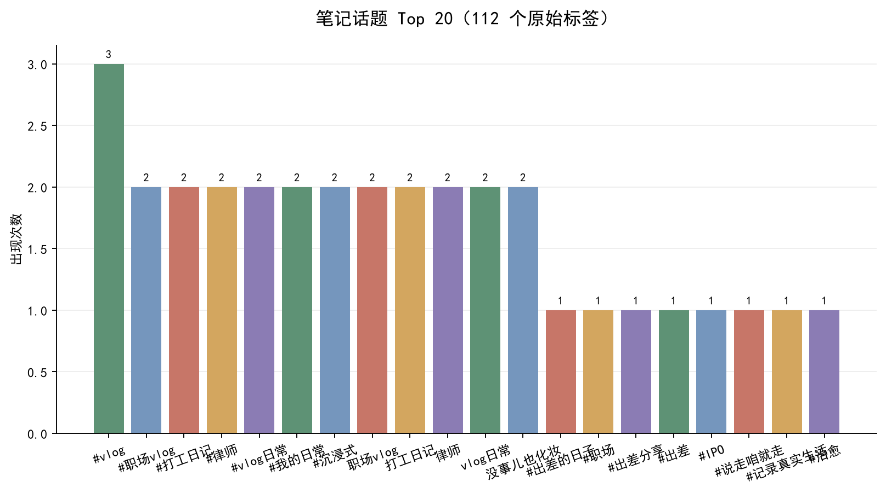
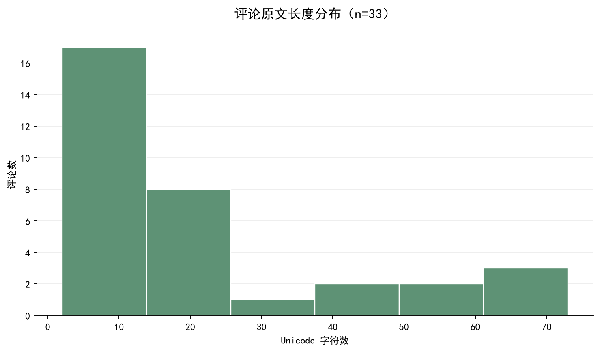
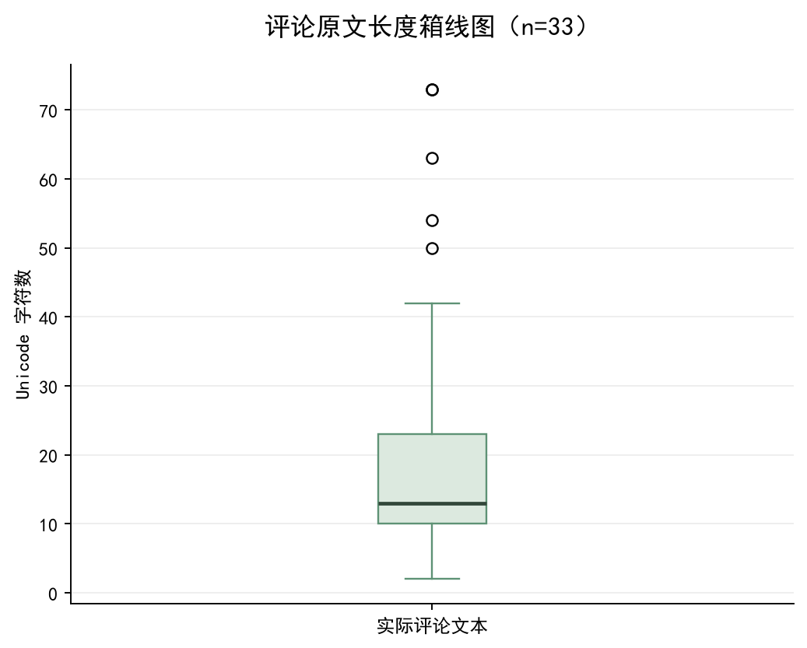
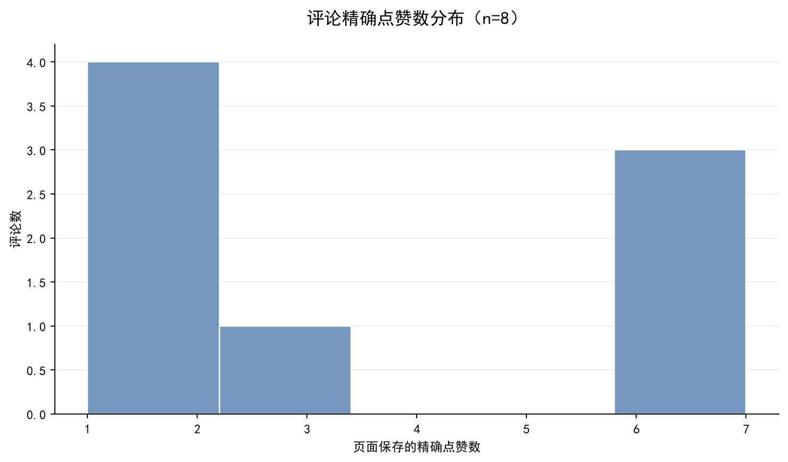
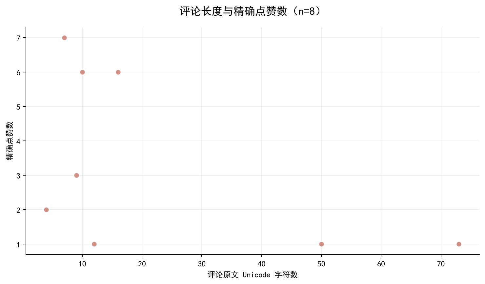
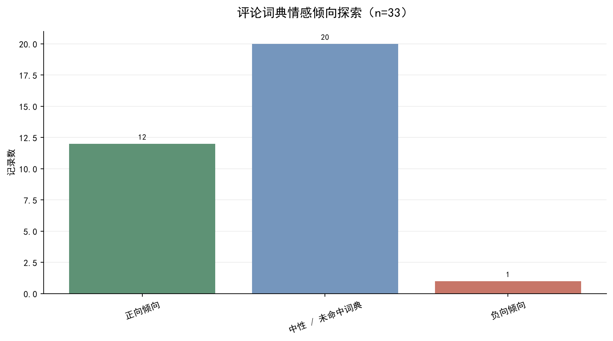
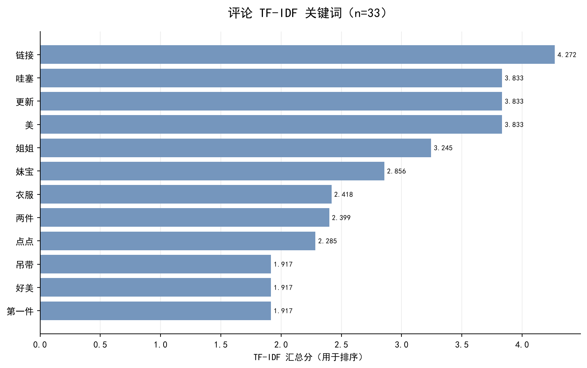
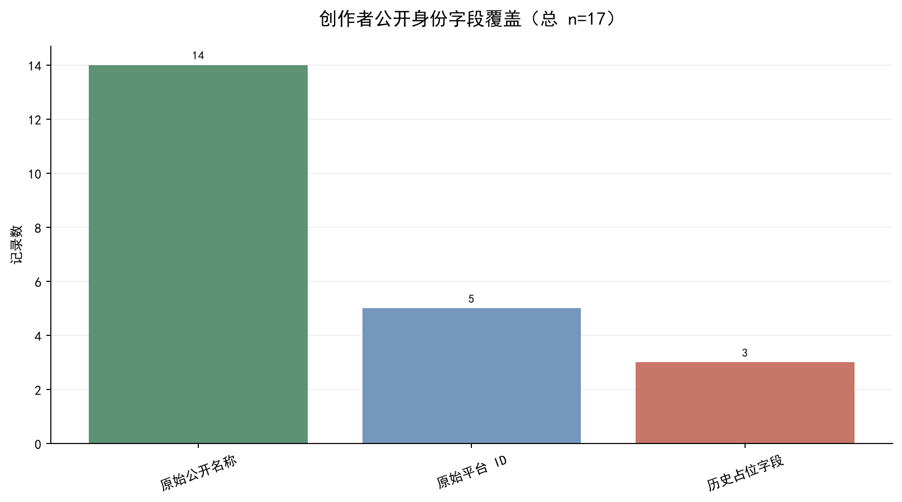
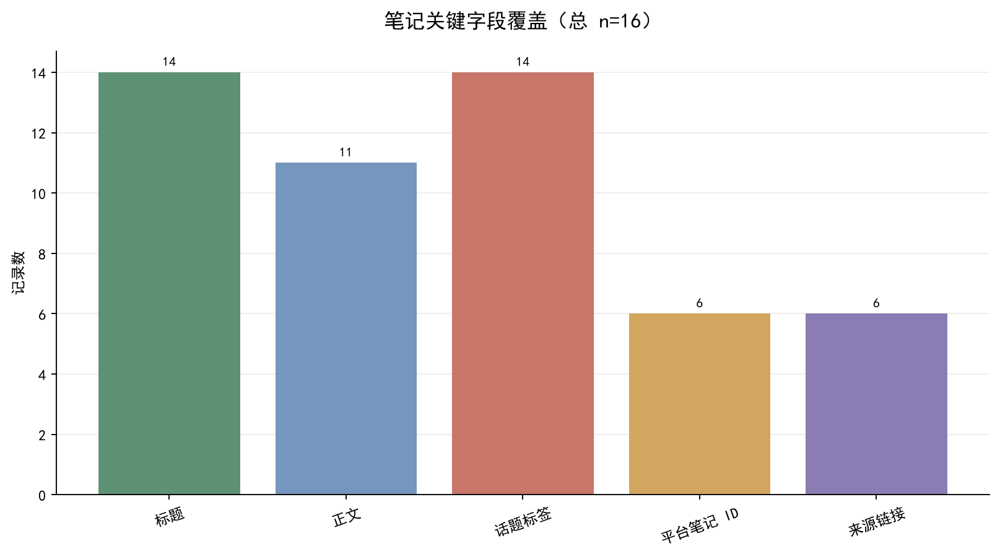
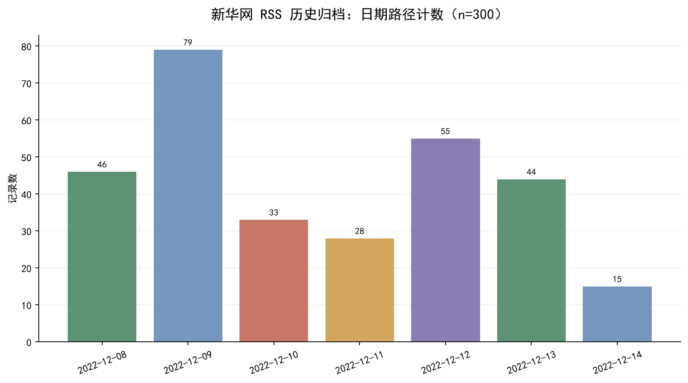

# CreatorScope V1.2 数据分析报告

日期：2026-11-21 | 项目：CreatorScope | 分支：main

## 1. 目标与范围

本报告核对当前正式 SQLite 数据库中的字段覆盖和样本，说明 V1.2 已实现的统计流程，并用只读审计副本和本机新闻 RSS 数据生成实际图表。社交平台原始公开名称、平台 ID、笔记标题/正文/话题、评论原文及指标原值不作匿名替换；标准化值和清洗文本单独存放。认证密码、Cookie、Session、访问 Token 不作为课程采集数据保存。

真实数据、历史导入、测试夹具、Mock AI 和实时模型调用分别记录。测试夹具与 Mock 输出不进入本报告样本和图表。

## 2. 数据来源与采集环境

- 正式库：instance/creatorscope_unified.sqlite3。统计使用 SQLite backup API 生成的只读审计副本；正式库文件 SHA-256 为 4F044C4C7E2205EEA402AEF98AE97B3C5678EDCD55D5D165551B22839231654A。副本完整性检查为 ok，外键违规为 0；副本 SHA-256 为 D5B65B9DD6C8E4FAB34797B5AEA870355448DC6FB92751A0C2149F6345100EF5。
- 数据库表计数：tasks 18、batches 12、creators 17、notes 16、records 92、metric_values 472、comment_snapshots 33。新闻 RSS 单独保存为本机 instance/news_items.jsonl，不写入正式 SQLite。
- 环境：Windows 本机 Python 虚拟环境、Flask、SQLite、Playwright 可见浏览器和 ECharts 页面。应用地址为 http://127.0.0.1:8765。
- 历史库含历史导入、之前可见页面采集和测试记录来源；不能将全部 92 条记录称作本轮实时采集。
- 本轮社交平台新增创作者、笔记、评论均为 0。现有采集器状态为 reachable 但没有打开页面；蒲公英页面处于需要重新登录的路由，浏览器工具无法建立页面绑定。没有重试登录、绕过验证码或伪造样本。既有一条停止批次记录为 0 条成功记录、4 个错误；本轮没有启动新的社交采集，所以本轮成功率不计算。
- 新华网时政 RSS 作为独立公开来源采集 300 条。来源目录见[新华网 RSS 目录](https://www.news.cn/linktous.htm)，实际 feed 为[新华网时政 RSS](https://www.xinhuanet.com/politics/news_politics.xml)。所获项目的 RSS 发布时间字段为空；300 条日期均从原文 URL 路径解析，范围为 2022-12-08 至 2022-12-14。它们是历史归档，不代表当前热点。

## 3. 字段覆盖与数据质量

| 对象 | 覆盖结果 | 分析影响 |
|---|---|---|
| 创作者 | 17 个实体；14 个原始公开名称，5 个原始平台 ID；领域、地域、粉丝字段各 6/17。3 个早期内部占位字段没有原始名称可恢复。 | 当前粉丝与报价联合有效样本各 2；分布和散点只作样本描述。 |
| 笔记 | 16 篇；标题 14/16、正文 11/16、话题 14/16（共 125 个标签）、平台笔记 ID 6/16、来源链接 6/16、发布时间 11/16、类型 13/16。 | 没有正文的笔记不参与正文词云，不用标题替代正文。 |
| 指标 | 472 个 metric_values；numeric_value 非空 405 个。保留 raw_value、normalized_value、unit、period、parse_status。 | 页面缺失符号、空值、起价和非精确值不填 0，也不伪装为精确值。 |
| 评论 | 33 条原文；32 条一级评论、1 条回复；点赞原始值 17/33、精确点赞数 8/33；回复原始值 26/33。 | 词云和情感只代表本地已有评论；实际来源没有保存评论者名称、账号或主页信息。 |

完整逐字段、来源和批次覆盖见 DATA_FIELD_COVERAGE.zh-CN.md。结构和实现现状见 ANALYTICS_IMPLEMENTATION_MATRIX.zh-CN.md。

## 4. 方法与真实样本图表

清洗过程保留原始字段。指标解析结果独立存储；文本分析以原文进行 jieba 分词，应用项目停用词表；停用词过滤不改写数据库原文。评论 TF-IDF 使用按文档词频和逆文档频率计算的纯 Python 实现，主题类别仍由可解释关键词规则产生。图表由 scripts/generate_v1_2_report_charts.py 根据只读快照和本地 RSS JSONL 生成，样本数写在图题和 v1_2_chart_manifest.json 中。

### 标题、正文与评论词云

标题词云使用 14 篇非空标题，正文词云使用 11 篇非空正文，评论词云使用 33 条评论原文；三者各自处理，不混为一个语料。

话题频率 Top 20 基于 125 个原始标签；完整图表为 。

### 评论长度、点赞和情感探索

评论长度直方图和箱线图均使用 33 条原文；长度为 Unicode 字符数。精确点赞直方图与长度-点赞散点仅用 8 条精确点赞记录，不把诸如“10+”的显示值转换成 10。散点仅描述本地样本，不作因果解释。

情感词典探索结果为正向 12 条、中性/未命中 20 条、负向 1 条；这不是人工金标准，也不能确定用户真实情绪。评论页提供稳定抽样的人工复核 CSV，最多 20 条，人工标签列留空供课程复核。TF-IDF 按 33 篇评论文档计算关键词排序，并按笔记与创作者返回分组词项。

### 其他覆盖图和新闻归档时间分布

新闻时间图仅展示从 URL 路径推导的 300 条归档日期，不作当前新闻趋势解释。

跨批次趋势算法必须精确匹配 note_id、source、metric_key、period，并至少有两个采集时间点。当前正式库符合条件的重复笔记指标序列为 0，因此没有绘制增长曲线。

## 5. 11 项功能结论

当前每项功能、代码位置、字段口径和后续限制见[分析实现矩阵](ANALYTICS_IMPLEMENTATION_MATRIX.zh-CN.md)。已经具备 P0 统计、词云、评论分布和筛选流程；受众与对比分析按兼容来源/周期运行。TF-IDF 和词典情感为探索性。跨批次趋势因重复快照为 0 而阻塞。

AI 页支持 7 种预览分析类型与本机报告持久化；笔记正文和评论原文是否纳入模型输入可单独选择，默认关闭；必须先检查当前范围预览并勾选确认才会向模型服务商发送数据。关闭原文选项只影响模型输入，不改变本地原始字段和导出。报告保存模型名称、输入批次/实体 ID、分析时间、事实原文和输出，不保存 API Key。当前状态只检查到 DeepSeek 的服务器环境变量有密钥，所有服务商均未配置模型 ID；本轮真实模型调用为 0。自动化测试中的 AI 输出是 Mock。

新闻模块保留 RSS 来源和文章 URL，对新闻词项与所选笔记标题/话题作匹配，按事件前后各 7 日展示已匹配笔记数；互动均值需同一来源、同一指标周期和四项完整指标。新闻关联是描述性时间比较，不代表因果。

## 6. 图表复现

在项目根目录用虚拟环境运行以下命令。输入数据库应为审计副本；脚本以只读方式打开输入并在内存中建立快照。

    .\.venv\Scripts\python.exe scripts/generate_v1_2_report_charts.py --database _preview/v1_2_audit_20261121/creatorscope_unified_readonly_audit.sqlite3 --news-jsonl instance/news_items.jsonl

输出目录为 docs/assets/v1.2/；数据计数和图片清单写入 v1_2_chart_manifest.json。审计副本和 RSS JSONL 是本机数据文件，不随源码提交。

## 7. 不足与后续

1. 正常页面采集尚未新增社交样本；需在用户本人完成正常登录后，从可见页面补齐创作者、笔记、评论和同一笔记的重复快照。
2. 三个旧库内部占位字段无法从现有原始记录恢复；后续只在实际页面重新可见时补上。
3. 受众画像的可兼容源/周期少，评论样本只有 33 条；应继续把结果称为探索性样本。
4. 新闻 feed 当前返回历史归档，时间主要由 URL 路径推导；不要称作实时新闻。
5. 当前没有配置模型 ID；即使服务器有 API 密钥，也未进行模型请求。真实模型报告仍未验证。
